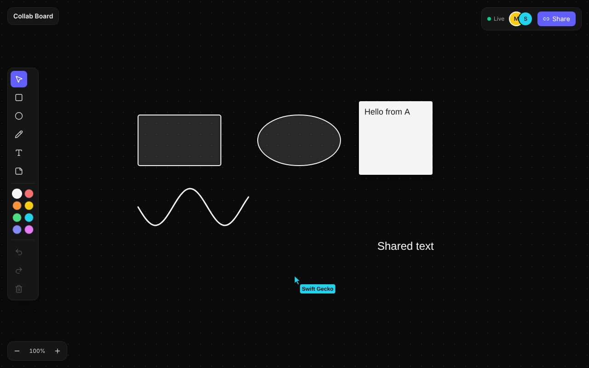

# Collab Board

Real-time collaborative whiteboard built with Next.js, TypeScript, Konva, Yjs and PostgreSQL.

**Live demo:** https://collab-board-jet-seven.vercel.app (open a board in two tabs and draw)



## How it works

```
Browser (React + Konva)
   │  edits applied locally, instantly
   ▼
Yjs document (CRDT)  ◄── WebSocket ──►  Node sync server (ws + y-protocols)
                                              │
                                      PostgreSQL (debounced snapshots,
                                      flushed on last disconnect and SIGTERM)
```

- Each shape is a `Y.Map`, so two users editing different properties of the same shape merge without conflicts.
- Cursors, names and in-progress drawings travel over Yjs awareness, throttled to 40ms.
- Undo/redo is per user (`Y.UndoManager` tracking only local edits), so you never undo a collaborator's work.
- The server buffers early client messages while a room loads from Postgres, enforces an origin allowlist, and flushes boards on shutdown.
- Rendering uses memoized Konva nodes, and only shapes that changed are rebuilt on each update.

## Stack

- Next.js (App Router), TypeScript, Tailwind
- react-konva for canvas rendering
- Yjs CRDT with a custom WebSocket sync server (`ws` + `y-protocols`)
- PostgreSQL for board snapshots

## Getting started

```bash
cp .env.example .env
docker compose up -d
npm install
npm run dev
```

Web app runs on `http://localhost:3000`, realtime server on `ws://localhost:1234`.

## Scripts

| Script | Purpose |
| --- | --- |
| `npm run dev` | Web app and realtime server together |
| `npm run typecheck` | Type-check web and server code |
| `npm run build` | Production build of the web app |
| `npm run start:server` | Run the realtime server |
| `npm run test:sync` | Sync smoke test against a running server (`EXPECT_PERSISTENCE=1` with Postgres) |

## Roadmap

- [x] Project setup, realtime server, persistence
- [x] Canvas with shapes, pen, text, sticky notes
- [x] Yjs sync, live cursors, presence
- [x] Per-user undo/redo, zoom/pan
- [ ] Resize handles, export to PNG
- [x] Deployment config (Render + Vercel + Neon), CI

## Deployment

| Part | Host | Settings |
| --- | --- | --- |
| Database | Neon (free Postgres) | Copy the connection string |
| Realtime server | Render, from `render.yaml` | `DATABASE_URL` = Neon string, `ALLOWED_ORIGINS` = your Vercel URL |
| Web app | Vercel | `NEXT_PUBLIC_WS_URL` = `wss://<render-service>.onrender.com` |

Set `NEXT_PUBLIC_WS_URL` before the first Vercel build, since it is baked in at build time. Render's free tier sleeps after 15 minutes idle; the client reconnects automatically and boards are restored from Postgres.

## Shortcuts

`V` select, `R` rectangle, `O` ellipse, `P` pen, `T` text, `S` sticky note, `Del` delete, `Ctrl+Z` undo, `Ctrl+Shift+Z` redo, `Space`+drag pan, scroll to zoom.
